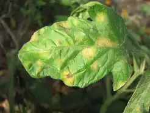

# Crop Disease Detection
Deep learning based crop disease detection using leaf image classification and severity analysis.
## Problem
Crop diseases reduce yield. This project detects the disease from a leaf photo and estimates how severe it is.
## How it works 
1. Upload a leaf image
2. Model classifies the disease
3. Severity level is calculated (low / medium / high)
## Tech used 
- Python
- Deep learning (CNN)
- OpenCV
 ## How to run
1. Install libraries: `pip install -r requirements.txt`
2. Put your images in a `dataset/` folder (one subfolder per disease)
3. Train the model: `python train.py`
4. Test a leaf image: `python predict.py leaf.jpg` 
## Status
Code Uploaded. Model training ang result in progress
## Sample Images

.webp)
